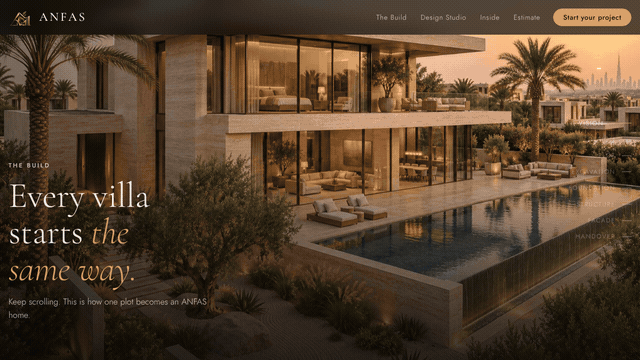
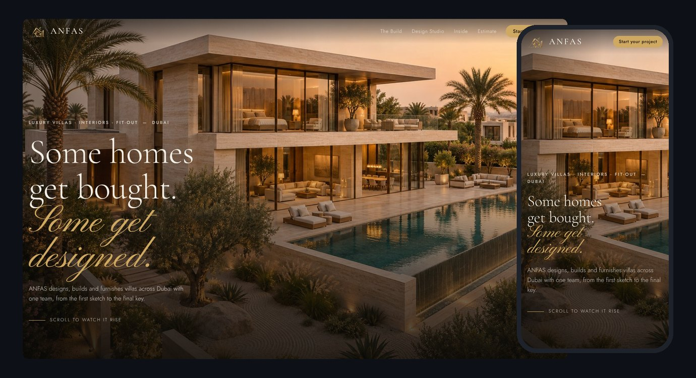

<div align="center">
  
  <h1>ANFAS Villa</h1>
  <p><b>A cinematic scroll story that builds a Dubai villa from the first line to handover.</b></p>
  <p>
    <a href="https://dariush-tech.github.io/anfas-villa/"><b>Live demo</b></a> ·
    <a href="#how-the-build-story-works">How it works</a> ·
    <a href="#run-locally">Run locally</a>
  </p>
  <p>
    
    
    
    
  </p>
  
</div>

## Overview

Built for **ANFAS Mutanasiqa Decoration L.L.C**, a villa, interiors and fit-out company in Dubai.
Scrolling plays the life of one villa: **design → plot → excavation → foundation → structure → facade → handover**.
One static HTML file, no framework, no build step.



## Features

- **Build story.** A sticky full-screen stage where scroll drives the crossfades between seven construction stages, with captions and a progress rail.
- **Line drawing.** A gold line drawing traced from the final render (OpenCV edge extraction) glows over the villa as the story begins.
- **Design studio.** Try the facade in limestone, basalt or sand before anything is built.
- **Inside.** Living room, majlis and master suite in tabs.
- **Project estimator.** Design, fit-out or full build; area and finish level give a budget range, time to handover and a cost breakdown.
- **Accessible and calm.** Native inputs styled as controls, visible focus states, `prefers-reduced-motion` support and phone layouts.

## How the build story works

The `#build` section is `760svh` tall with a `position: sticky` stage inside. On each animation frame the script maps scroll progress to a stage index and a local progress value, then sets each layer's opacity with an ease curve, so the stages hand over smoothly in both scroll directions without any animation library.

## Project structure

```
anfas-villa/
├── index.html      # markup, styles and scripts (single file, no build step)
├── img/
│   ├── line, land, ground, pour, structure, facade, villa, dusk .jpg   # build stages
│   ├── outline.png                                                     # traced line drawing
│   ├── finish-*.jpg, inside-*.jpg                                      # studio and interiors
│   └── emblem.png, lockup.png
└── docs/           # README media
```

## Run locally

```bash
git clone https://github.com/dariush-tech/anfas-villa.git
cd anfas-villa
python3 -m http.server 8000
# open http://localhost:8000
```

## Notes

- Images are AI-generated concept visualisations, not photographs of completed projects.
- Estimator rates are indicative placeholders (AED per sq ft), kept in the `RATES` object in `index.html`.

## Credits

Client: ANFAS Mutanasiqa Decoration L.L.C, Dubai · Design & development: [Dariush Technology](https://github.com/dariush-tech)

Brand assets © ANFAS Mutanasiqa Decoration L.L.C. All rights reserved.
